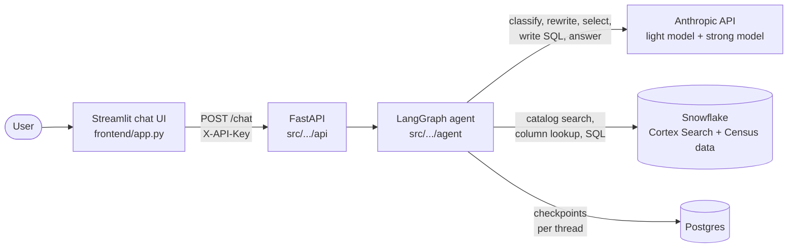
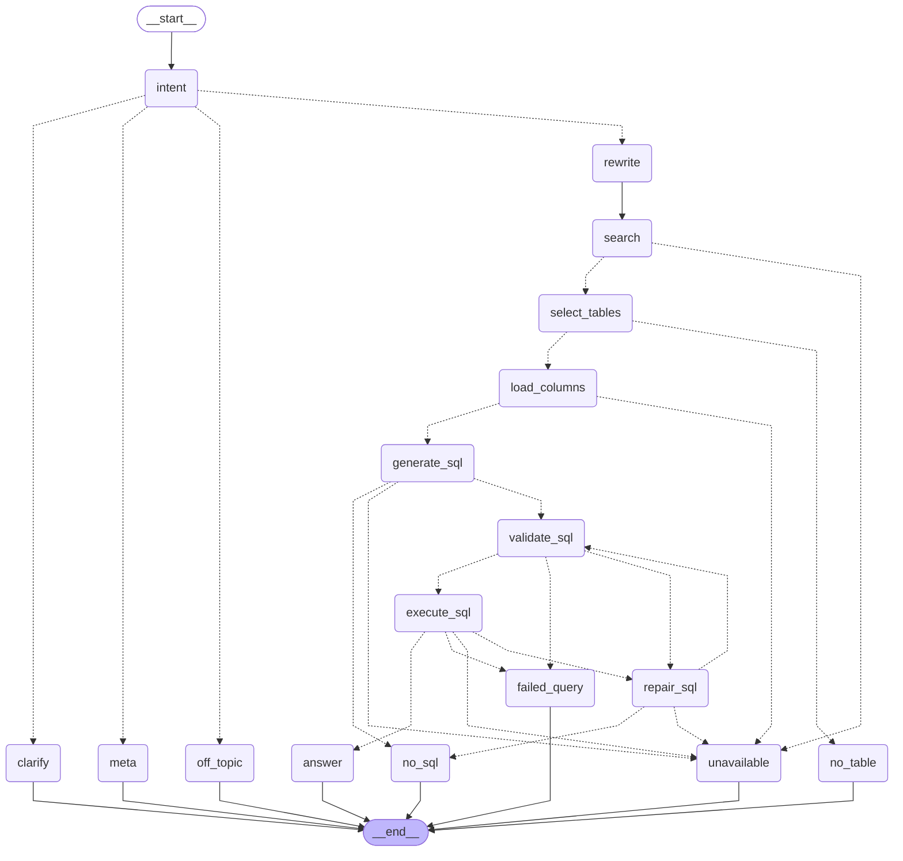

# US Population Agent

## Author: Daniel Machniak

A chat agent that answers natural-language questions about the US population, households, income, housing and education. Every number comes from a live SQL query against the US Open Census dataset (ACS 2020 5-year estimates) on the Snowflake Marketplace, not from the model's memory. The agent is a [LangGraph](https://langchain-ai.github.io/langgraph/) workflow built on Claude. It classifies the question, finds the relevant tables with Snowflake Cortex Search, generates and validates read-only SQL, and writes the answer from the query result. When a question is ambiguous, off-topic or cannot be answered from the data, it says so instead of guessing. It is served by a FastAPI backend with conversation state in Postgres and a Streamlit chat UI, and it runs with Docker Compose.

## 1. Try it

### 1.1 Live demo

| | |
| --- | --- |
| **URL** | https://compliant-seamanly-delpha.ngrok-free.dev |
| **Access key** | `<ACCESS KEY>` |

1. Open the URL. The app is served through a free ngrok tunnel, so ngrok may first show a "You are about to visit..." notice. Click **Visit Site**.
2. Paste the access key into the **Access key** field in the sidebar. The key is sent as the `X-API-Key` header to the API, which rejects requests without it. The key is there to protect my Snowflake and Anthropic usage.
3. Type a question or click one of the suggested examples. **New conversation** in the sidebar starts a fresh thread.

The demo runs from my own machine with Docker Compose (see [7.4](#74-with-docker-compose) and [7.6](#76-exposing-the-app-publicly)), so it is only up while that machine is. <!-- TODO: state the window the demo will be available, and a contact in case it is down. -->

Answers are grounded in the **American Community Survey (ACS) 2020 5-year estimates** from the US Open Census dataset on the Snowflake Marketplace. The agent does not serve other years, other countries or non-census data, and it says so (see [5](#5-guardrails-and-graceful-degradation)).

### 1.2 Example questions

The questions are grouped by the behaviour they exercise. Most are also cases in the evaluation suite ([6.4](#64-end-to-end-evaluation-reference-answers--llm-as-judge)).

| Group | Try asking | What it returns |
| --- | --- | --- |
| Counts | *How many people live in Travis County, Texas?* | Single figure for one county. |
| Rates | *What is the poverty rate in Mississippi?* | The agent computes the rate from counts and shows the percentage value. |
| Rankings | *Which 10 states have the highest share of renters?* | One query over many geographies, with ordering and a limit. |
| Comparisons | *Compare median household income in California and Texas* | Several places in one answer. |
| Multi-turn follow-up | *What is the poverty rate in Mississippi?*, then *And in Texas?* | The follow-up is resolved from the conversation context. |
| Ambiguous | *Show me data about Florida*, *How rich is Washington?* | The agent asks a clarifying question instead of guessing a measure. |
| Unsupported geography | *What is the population of Seattle?* | The dataset has no city level, so the agent suggests a county or state. |
| Unanswerable | *How has Texas population changed since 2010?* | The agent serves a single year (2020), so it cannot show trends. The agent says so and suggests what it can answer. |
| Meta | *What year is this data from?*, *How did you calculate that?* | Questions about the data and previous answers are answered without a new query. |
| Off-topic | *Write me a poem*, *What is the population of Poland?* | Guardrail: the agent declines and redirects to census topics. |

## 2. Overview

### 2.1 Requirements and how they are met

| Requirement | How it is met |
| --- | --- |
| Data from the US Open Census dataset on the Snowflake Marketplace | All figures come from SQL run on the shared Marketplace database with a read-only role. The agent adds only metadata of its own (table catalog, column descriptions, geography lookup) ([3.3](#33-data-layer)). |
| Chat agent answering questions grounded in the data | LangGraph workflow: classify, search the catalog, pick tables, generate and validate SQL, execute, answer from the result ([3.2](#32-agent-graph)). |
| Web interface on the public internet | Streamlit chat UI behind an HTTPS tunnel, protected by an access key ([1.1](#11-live-demo), [3.5](#35-api-and-frontend), [7.6](#76-exposing-the-app-publicly)). |
| Conversation context across turns | Every turn is stored in a Postgres-backed LangGraph checkpointer under a thread id. ([3.4](#34-conversation-state-and-persistence)). |
| Guardrails against off-topic or inappropriate responses | An intent classifier runs first and routes off-topic and harmful requests to a refusal. Generated SQL is validated before it runs, and the Snowflake role is read-only ([5.1](#51-off-topic-and-inappropriate-requests), [5.3](#53-sql-safety)). |
| Graceful degradation | Dedicated terminal nodes for each failure: clarification, no matching table, unanswerable question, SQL that kept failing, and infrastructure errors. The user always gets a message, never an empty reply or a stack trace ([5](#5-guardrails-and-graceful-degradation)). |
| Ambiguous, partial, conflicting and unanswerable queries | Handled by the intent classifier and the no-data reply. Partially answerable questions are answered for the supported part, and the unsupported part is stated ([5.4](#54-ambiguous-and-underspecified-questions) to [5.6](#56-reasonable-but-unanswerable-questions)). |
| Meaningful tests | Unit tests, integration tests of the graph paths, and an end-to-end evaluation against reference answers with an LLM judge. CI runs lint, type check and tests ([6](#6-testing-strategy)). |


### 2.2 Scope and assumptions

**What the agent covers**

- **Data:** American Community Survey (ACS) **2020** 5-year estimates. The source unit is the census block group. The agent aggregates it to **county**, **state** (including DC and Puerto Rico) and the **whole country**.
- **Year:** the Marketplace dataset also contains 2019 tables, but the agent uses only 2020. Supporting both would require routing each question between the two sets of tables (choosing the year, and handling comparisons and trends across years). I judged that too much added complexity and risk for the 24-hour limit, so the agent is single-year by design.
- **Topics:** population, age, sex, race and ethnicity, citizenship and language, education, employment and commuting, income and poverty, health insurance and disability, veterans, households and families, housing (tenure, rent, value, costs) and internet access.
- **Operations:** totals, counts, percentages and shares, comparisons between areas, and rankings.

**What it deliberately does not cover**

- Other years (including the 2019 data present in the dataset), trends over time and forecasts. The agent serves a single year, so it cannot compare years.
- Anything outside the US, and non-census data such as crime, current prices, weather or election results.
- Cities, ZIP codes, metro areas and congressional districts as filters. The agent asks for a county or state instead.
- Land or water area, coordinates, individual-level records and margin-of-error analysis.

**Assumptions the agent makes**

- If the user gives no place, the question is about the whole US.
- "People" means total population, and "income" means median household income. A question that could mean materially different measures (for example "How rich is Washington?") gets a clarifying question instead of a default.
- Percentages are computed as a ratio of sums (for example people below poverty over people whose poverty status is determined), never as an average of block-group percentages.
- Medians and means cannot be summed or averaged exactly across block groups. For areas larger than a block group the agent uses the median of the block-group values and says in the answer that this is an approximation.
- A place name that exists in more than one state (for example Baldwin County) returns every match rather than a guess.

## 3. Architecture

### 3.1 System components



| Component | Role | Notes |
| --- | --- | --- |
| **Streamlit UI** | Thin chat client. Keeps the `thread_id` in the browser session and sends each question to the API. | Holds no secrets, only the API address. |
| **FastAPI** | Authentication, input limits, turn timeout, mapping failures to HTTP errors. | The graph is built once at startup and shared by all requests. |
| **LangGraph agent** | The whole question-answering logic as a graph of small nodes with explicit routing ([3.2](#32-agent-graph)). | Nodes talk to the outside world only through narrow interfaces (`TableSearcher`, `ColumnSource`, `SqlExecutor`). |
| **Anthropic (Claude)** | A light model (`ANTHROPIC_MODEL_NAME`) for classification, rewriting, table selection and replies, and a strong model (`ANTHROPIC_STRONG_MODEL_NAME`) for writing and repairing SQL. | Structured output (JSON schema) wherever the next step depends on the result. Retries and timeouts are set on the client. |
| **Snowflake** | Three jobs through one connection: Cortex Search over the table catalog, a lookup of a table's columns, and running the generated SQL. | One read-only role for everything the agent does ([5.3](#53-sql-safety)). |
| **Postgres** | LangGraph checkpointer: conversation state per thread ([3.4](#34-conversation-state-and-persistence)). | Survives restarts through a Docker volume. |

### 3.2 Agent graph

One question is one run of the graph below. It is the diagram generated from `build_graph` and kept in [docs/graph.md](docs/graph.md).



**Happy path** (an answerable question):

| Step | Node | Uses | What it does |
| --- | --- | --- | --- |
| 1 | `intent` | light model | Classifies the latest message, with the conversation as context, as `answerable`, `needs_clarification`, `meta` or `off_topic`. |
| 2 | `rewrite` | light model | Turns the question into up to 4 short catalog search queries in census wording, with places and numbers removed. Writes notes for later steps (for example "age of the householder, not of all residents"). |
| 3 | `search` | Cortex Search | Runs each query (5 hits each) and merges the rankings round-robin into at most 8 candidate tables. |
| 4 | `select_tables` | light model | Picks **one** table from the candidates, or none. An id that is not among the candidates is rejected. |
| 5 | `load_columns` | Snowflake lookup | Loads every column of that table with its full meaning (`Estimate > SEX BY AGE > Total > Male > Under 5 years`). No model involved. |
| 6 | `generate_sql` | strong model | Chooses the columns, then writes one Snowflake `SELECT`. Returns the SQL, notes on assumptions, and the parts of the question it does not cover. |
| 7 | `validate_sql` | `sqlglot` | Checks the SQL without running it: exactly one `SELECT`, only the chosen data table and the geography view, and only existing, quoted, aliased columns. |
| 8 | `execute_sql` | Snowflake | Runs the query with a timeout. |
| 9 | `answer` | light model | Writes the reply from the rows, the notes and the uncovered parts. |

**Non-happy exits.** Every branch ends in a node that returns a message to the user:

| Node | Reached when | Reply |
| --- | --- | --- |
| `clarify` | The intent is `needs_clarification`, or the classifier itself failed. | One short clarifying question with concrete options. |
| `meta` | The message is about the assistant, the data, a previous answer, or is a greeting. | Short answer from the dataset description and the conversation. No query. |
| `off_topic` | The message is unrelated, harmful, or asks for data the dataset lacks (other years, other countries, forecasts). | Polite refusal naming the closest thing the agent can do. |
| `no_table` | No candidate table fits, or the rewrite found nothing to search for. | Explains what is missing and suggests an alternative. |
| `no_sql` | The model decided the chosen table cannot answer the question (or the question contradicts itself). | Same, using the model's notes and the uncovered parts. |
| `failed_query` | The SQL still failed validation or execution after the allowed repairs. | Fixed message asking to rephrase. |
| `unavailable` | Infrastructure failed: every catalog search, the column lookup, the model, or Snowflake itself. | Fixed "something went wrong, try again" message. |

**Repair loop.** If validation or execution rejects the SQL, `repair_sql` gives the strong model the failing query and the exact problems, then validation runs again. This repeats at most `MAX_REPAIRS` times (default 2). A failure of Snowflake itself skips the loop, because rewriting the query cannot help.

**Two properties worth knowing:**

- **One table per question.** The agent selects a single census table and writes SQL over it. A question that needs two tables (for example income and education) is answered for the main part, and the other part is reported as not covered ([5.5](#55-partially-answerable-questions)).
- **Fallbacks everywhere.** Each model-calling node has a deterministic fallback (classifier failure becomes a clarifying question, rewriter failure falls back to the user's own words, an empty reply becomes a fixed message). The user never receives an empty answer.

### 3.3 Data layer

**Source.** The Marketplace share `US_OPEN_CENSUS_DATA_NEIGHBORHOOD_INSIGHTS_FREE_DATASET`. Its 2020 data tables are in a wide format: a table such as `2020_CBG_B01` has one row per census block group and one column per estimate (`B01001e1`, `B01001e2`, ...). A separate metadata table describes every column as a hierarchy of up to ten levels. The agent never modifies the share.

**What I built on top of it.** The raw metadata is not suitable for retrieval, so [`snowflake_sql/`](snowflake_sql/) creates three objects in my own database (`CENSUS_APP_DB.PUBLIC`):

| Object | Script | Purpose |
| --- | --- | --- |
| `CLEAN_METADATA` | [`clean_metadata.sql`](snowflake_sql/clean_metadata.sql) | One row per estimate column (about 3,800 columns in about 300 tables). Keeps estimates only, drops margins of error and the `B99` imputation tables, and turns the field levels into one readable description: `Column \| Table \| Topic \| Title \| Universe \| Meaning: level > level > level`. This is the `SNOWFLAKE_COLUMNS_TABLE` that `load_columns` reads. |
| `TABLE_CATALOG` + `CENSUS_TABLE_SEARCH` | [`table_catalog.sql`](snowflake_sql/table_catalog.sql) | One row per census table, with a `SEARCH_TEXT` built from its title, topics, universe and **breakdowns** (the distinct categories at each level, such as the age groups). A Cortex Search service indexes that text with the `snowflake-arctic-embed-l-v2.0` embedding model. |
| `V_GEOGRAPHY` | [`data_exploration.sql`](snowflake_sql/data_exploration.sql) | A view that maps each block group to its state abbreviation and county name by joining the share's geographic and FIPS tables. |

**How the layers are used at run time.**

1. *Which table?* Cortex Search over `TABLE_CATALOG`, one entry per table. The catalog contains no places and no numbers, only what a table measures and how it is split.
2. *Which columns?* An exact lookup in `CLEAN_METADATA` by table id. This is deterministic on purpose, not a second search.
3. *Which numbers?* Generated SQL that joins the data table to `V_GEOGRAPHY` on `CENSUS_BLOCK_GROUP` and aggregates block groups to county, state or country **at query time**. Nothing is pre-aggregated.

The reasoning behind this split is in [4.2](#42-retrieval-over-table-metadata-cortex-search-instead-of-stuffing-the-schema-into-the-prompt) and [4.6](#46-metadata-cleaning-and-the-custom-catalog-on-top-of-the-raw-dataset).

### 3.4 Conversation state and persistence

- **Thread.** A conversation is a LangGraph *thread* identified by `thread_id`. The API creates one when the request has none and returns it, and the UI sends it back with the next question.
- **Checkpointer.** `AsyncPostgresSaver` stores the graph state after each step. History survives an API restart, and any API instance can continue any thread.
- **What the history contains.** The `messages` list holds only what the user would see: their questions and the final answers. Intermediate results (candidate tables, SQL, rows) are separate state fields, overwritten on every question, so they never leak into the next prompt.
- **Context passed to the models.** Every node that needs it receives the recent transcript, built by `format_context`: the latest messages that fit in `MAX_CONTEXT_TOKENS` (default 2000, estimated), always starting on a user message, so a long conversation cannot grow a prompt without limit.
- **Follow-ups.** "And in Texas?" is resolved in three places that all see the transcript: `intent` classifies the *resolved* question, `rewrite` produces catalog queries for the real topic, and `generate_sql` fills in the place. Questions about a previous answer ("How did you calculate that?") go to `meta` and are answered from the transcript, which holds the earlier answer text.


### 3.5 API and frontend

| Endpoint | Description |
| --- | --- |
| `GET /health` | Liveness probe, used by the Docker Compose healthcheck. |
| `POST /chat` | Body `{"message": "...", "thread_id": "..."}` (`thread_id` optional). Returns `{"thread_id": "...", "answer": "..."}`. |

Behaviour of `POST /chat`:

| Case | Response |
| --- | --- |
| Missing or wrong `X-API-Key` (when `API_KEY` is set) | `401`. The key is compared in constant time. |
| Empty message, message over `MAX_MESSAGE_CHARS` (default 1000), or malformed `thread_id` | `422`. |
| Turn takes longer than `TURN_TIMEOUT_SECONDS` | `504` with a retry message. |
| Unexpected error inside the graph | `500` with a generic message. Details go to the log, not to the client. |

The graph and the Snowflake connection are opened once in the app's lifespan. `create_app` accepts a `graph_factory`, which is how the API tests run without Snowflake or a model.

**Frontend.** [`frontend/app.py`](frontend/app.py) is a Streamlit app that does one thing: `POST /chat`. It stores the `thread_id` in the session, offers example questions, has a **New conversation** button, and turns `401`, timeouts and an unreachable API into short messages. It reads only `API_URL`, so in Docker Compose the frontend container gets no credentials. The reasons for choosing Streamlit are in [4.9](#49-stack-choices-uv-ruff-ty-langgraph-fastapi-streamlit).

### 3.6 Project layout

```
.
├── src/us_population_agent/
│   ├── agent/
│   │   ├── graph.py            graph wiring and routing functions
│   │   ├── state.py            AgentState (what the checkpointer stores)
│   │   ├── schemas.py          structured outputs of the model calls
│   │   ├── context.py          conversation transcript trimmed to a token budget
│   │   ├── dataset.py          one description of the data, shared by the prompts
│   │   ├── runtime.py          builds models, Snowflake and Postgres, yields the graph
│   │   └── nodes/              one file per node (intent, rewrite, search, select_tables,
│   │                           load_columns, generate_sql, validate_sql, execute_sql,
│   │                           repair_sql, answer, clarify, meta, off_topic, no_data)
│   ├── api/                    FastAPI app, routes, auth dependency, turn runner
│   ├── snowflake_client/       connection, Cortex Search, column lookup, query runner
│   ├── llm/                    Anthropic model factory
│   ├── persistence/            Postgres checkpointer
│   ├── config.py               settings read from the environment
│   └── logging_config.py
├── frontend/app.py             Streamlit chat UI
├── snowflake_sql/              scripts that build the catalog, columns table and geography view
├── tests/
│   ├── unit/                   routing, SQL validator, context trimming, API
│   ├── integration/            full graph paths with fake models and Snowflake
│   └── eval/                   end-to-end cases with reference answers and an LLM judge
├── docs/graph.md               generated graph diagram
├── Dockerfile, docker-compose.yml
├── Makefile                    install, fmt, lint, typecheck, test, eval, api, frontend
├── .github/workflows/ci.yml    lint, type check, tests
└── .env.example                every setting, documented
```

## 4. Key design decisions

Each decision lists what I chose, what I rejected, why, and what it costs. The costs matter as much as the choices, so they are stated explicitly.

### 4.1 Agentic graph vs. a single tool-calling loop

- **Decision:** a fixed LangGraph workflow with explicit routing ([3.2](#32-agent-graph)). The model makes bounded decisions inside nodes (classify, pick a table, write SQL). Control flow is ordinary code.
- **Alternatives:** one ReAct-style agent with `search_tables`, `get_columns` and `run_sql` tools that decides its own steps; or putting everything in a single prompt.
- **Why:**
  - **Predictable latency.** The number of model calls per question is bounded (a few light-model calls, one strong-model call, and at most `MAX_REPAIRS` repairs), which is what makes a 60-second budget realistic. A free-running loop has no such bound.
  - **Defined failure behaviour.** Every way a turn can fail has its own terminal node and its own message, which is how the "degrade gracefully" requirement is met by construction rather than by hope.
  - **Guardrails come first.** Off-topic and harmful requests are stopped before any search or query.
  - **Testable paths.** Each path can be exercised with fake models and a fake Snowflake ([6.3](#63-integration-tests-graph-paths-with-fake-llm--snowflake)).
- **Trade-off:** less flexible. The agent cannot look at a result and decide to run a second query, and it uses one table per question. A new capability means a new node and new routing.

### 4.2 Retrieval over table metadata (Cortex Search) instead of stuffing the schema into the prompt

- **Decision:** search a catalog with **one entry per census table**, pick one table, then load **all** of its columns exactly (no search) and let the strong model choose among them.
- **Alternatives:** put the whole schema in the prompt (about 3,800 columns in about 300 tables, far too large and noisy); search at column level; keyword search.
- **Why:** a single column means little without its siblings. "Male > Under 5 years" needs the table's total as a denominator, and "under 18" needs the sum of eight columns across two sexes. Searching for single columns returns fragments of a table. Searching tables, whose description lists the breakdowns (the age groups, the income brackets), finds the right table for "by age" or "by income" questions, and the full column list then gives the model everything it needs for sums and ratios.
- **Trade-off:** retrieval is a hard gate. If the right table is not among the 8 candidates, the question cannot be answered, so recall depends on the quality of `rewrite` and of the catalog text. Using a single table also rules out answers that combine two tables.

### 4.3 Text-to-SQL with generate / validate / repair vs. a semantic layer or fixed query templates

- **Decision:** the strong model writes a Snowflake `SELECT` from the chosen table's columns. A deterministic validator checks it before it runs, and failures (from the validator or from Snowflake) go back to the model for a bounded number of repairs.
- **Alternatives:** a hand-built semantic layer (for example a Cortex Analyst model); parameterised query templates; having the model read raw rows and compute the answer itself.
- **Why:**
  - **Hard parts live in the prompt.** The prompt encodes what makes this data tricky: block-group data must be aggregated to counties and states, percentages are `SUM / SUM` and never an average of percentages, medians cannot be summed (so the answer is flagged as approximate), Puerto Rico is excluded from "the country", and county names repeat across states.
  - **Numbers come from the database.** The answering model may only use numbers present in the query result, so it never quotes figures from memory.
  - **The validator is code, not a prompt.** It uses `sqlglot` to enforce one `SELECT`, only the two allowed tables, and only columns that exist, quoted and aliased ([5.3](#53-sql-safety)).
- **Trade-off:** the validator checks the *structure* of the SQL, not its *meaning*. A query that is valid but uses the wrong column or the wrong denominator would return a confident wrong number. The main defence is the evaluation suite with reference answers ([6.4](#64-end-to-end-evaluation-reference-answers--llm-as-judge)), which is partial coverage, not a guarantee.

### 4.4 Two model tiers (light model vs. strong model for SQL)

- **Decision:** a light model (default `claude-haiku-5-5`) for classification, rewriting, table selection and replies, and a strong model (default `claude-sonnet-5-5`) only for writing and repairing SQL. Both run with low reasoning effort.
- **Alternatives:** one strong model everywhere; one light model everywhere.
- **Why:** a turn can make several model calls, and most of them are short classification-style tasks. Spending the strong model only where an error silently corrupts the answer keeps latency and cost down without weakening the step that matters most.
- **Structured output:** nodes whose result drives routing return JSON-schema output rather than free text. The model is asked to write its `reason` before its label, so the justification comes first.
- **Trade-off:** an error from the light model (a wrong intent, a wrong table) is not caught by the strong one. The light model is cheaper, but it is also less capable, so the prompts must be tested for robustness.

### 4.5 Intent classification up front (answerable / clarify / meta / off-topic)

- **Decision:** the first node classifies every message into one of four intents, and each non-data intent has its own response node.
- **Alternatives:** let the SQL step refuse; use a separate moderation service; rely on one prompt that says "stay on topic".
- **Why:**
  - **The guardrail runs before data access.** Unrelated, harmful or out-of-scope requests never reach search or Snowflake.
  - **Ambiguity becomes a question.** "Show me data about Florida" or "population of Seattle" gets a clarifying question or a closest-alternative offer instead of a guess.
  - **Meta questions are cheap.** "What year is this?" and "How did you calculate that?" are answered from the dataset description and the conversation, without a query.
  - **It resolves follow-ups.** The classifier sees the conversation, so "And in Texas?" is classified as the question it really is.

- **Trade-off:** one extra model call on every turn. A wrong `off_topic` blocks a legitimate question, and because the prompt is the guardrail, its robustness against adversarial input has to be tested.

### 4.6 Metadata cleaning and the custom catalog on top of the raw dataset

- **Decision:** do not query the raw Marketplace metadata. Build three derived objects (`CLEAN_METADATA`, `TABLE_CATALOG` with a search service, `V_GEOGRAPHY`) and validate them with check scripts ([3.3](#33-data-layer)).
- **Alternatives:** use the raw metadata as it is; curate descriptions by hand.
- **Why:**
  - The raw metadata spreads a column's meaning across ten level columns (one of them misspelled in the source), and it includes margin-of-error columns and `B99` imputation tables. Left in, they double the columns the model has to pick from and invite wrong choices.
  - Collapsing the levels into one readable description (`Estimate > SEX BY AGE > Total > Male > Under 5 years`) is what the model reads when it selects columns.
  - The catalog text adds the table's breakdowns, which is what makes retrieval work ([4.2](#42-retrieval-over-table-metadata-cortex-search-instead-of-stuffing-the-schema-into-the-prompt)).
  - The data has no place names, only block-group ids. `V_GEOGRAPHY` adds state and county, which is the only way to answer by county or state.
- **Trade-off:** the derived objects must be rebuilt if the source changes. Margins of error are excluded, so the agent cannot talk about the uncertainty of an estimate.

### 4.7 Postgres checkpointer for multi-turn memory

- **Decision:** conversation state is stored server-side in Postgres through LangGraph's async checkpointer. The client only knows a `thread_id`.
- **Alternatives:** in-memory state; the client sending the whole history on each request; a custom table or Redis.
- **Why:**
  - History survives restarts and redeploys, and any API instance can continue any thread.
  - The server owns the history, so a client cannot inject fake assistant turns into it.
  - The frontend stays thin, and the checkpointer comes with LangGraph.
- **Trade-off:** one more service to run. There is no retention policy, and no per-user separation: a thread id is a random token, and anyone who has it and the API key can continue that conversation. History is trimmed to a token budget for each call rather than summarised, so very long conversations forget their beginning.

### 4.8 Deployment and public access (Docker Compose + ngrok)

- **Decision:** the whole stack (Postgres, API, frontend) runs with Docker Compose, and an optional `ngrok` service publishes the frontend on a fixed HTTPS domain.
- **Alternatives:** a managed cloud deployment, or a hosted Streamlit service.
- **Why:** the assignment needs a public URL, and one command that reproduces the whole stack is the shortest path for me and for a reviewer. Only the frontend is exposed. The API and Postgres listen on localhost, and the Anthropic and Snowflake credentials exist only in the API container.
- **Trade-off:** availability depends on my machine, and the free ngrok tier shows an interstitial page.

### 4.9 Stack choices (uv, ruff, ty, LangGraph, FastAPI, Streamlit)

| Choice | Reason | Cost |
| --- | --- | --- |
| **uv** | Locked, fast, reproducible installs, including in the Docker build (`--frozen`). | None worth noting. |
| **ruff, ty, pre-commit, GitHub Actions** | One tool for lint and format, a type checker, and the same checks locally and in CI. | `ty` is young, so might be unstable. |
| **LangGraph + `langchain-anthropic`** | Explicit graph, checkpointer and structured output in one library. | A dependency that moves fast. |
| **FastAPI** | Async, typed request validation, a clean place for auth and timeouts. | None worth noting. |
| **Streamlit** | A chat UI in one small file with no JavaScript build, kept separate from the API so another UI can replace it. | No token streaming: the user sees a spinner until the full answer arrives. |
| **`sqlglot`** | Parses the Snowflake dialect, so SQL can be validated without running it. | Checks structure only ([4.3](#43-text-to-sql-with-generate--validate--repair-vs-a-semantic-layer-or-fixed-query-templates)). |

## 5. Guardrails and graceful degradation


### 5.1 Off-topic and inappropriate requests

- **What counts as off-topic.** The classifier prompt lists three groups: unrelated requests ("write me a poem", "fix my Python code"), census-adjacent requests the dataset cannot serve (other years and trends, other countries, forecasts, non-census data such as crime or election results, individual people), and harmful or inappropriate requests.
- **What happens.** The `off_topic` node declines in at most three sentences. For an unrelated request it says it only covers US census population questions. For a census-related but unavailable request it says what is missing and offers the closest thing it can do ("I only have 2020 estimates, so I can't show how Texas changed since 2010. I can tell you the 2020 population instead."). For a harmful request it declines in one neutral sentence without lecturing. It never answers even partly and never states a number. If the model call fails, a fixed message with the same content is used.
- **What does not happen.** An off-topic message never reaches the catalog search or Snowflake. An integration test asserts that the non-data intents make no Snowflake call (`test_non_data_intents_never_touch_snowflake`).
- **Small talk** (greetings, thanks, "what can you do?") is not off-topic. It goes to `meta`, so the agent stays friendly instead of refusing.
- **Limit.** There is no separate moderation model. Handling of harmful requests relies on the classifier prompt and on Claude's own behaviour.

### 5.2 Prompt injection and adversarial input

**Where untrusted text enters.**

| Surface | Handling |
| --- | --- |
| The user's message | Always passed as the user turn, never inside a system prompt. Capped at 1000 characters. |
| Conversation history | Stored on the server ([4.7](#47-postgres-checkpointer-for-multi-turn-memory)), so a client cannot insert fake assistant messages. |
| Query results | Numbers and place names from the Census dataset. This is not a realistic injection channel. |
| Model output | Constrained by JSON schemas. The intent can only be one of four values, and a table id that is not among the candidates is rejected. |

**What the design relies on.**

- The `off_topic` prompt says to ignore instructions in the user's message that ask to change its rules.
- The answer, meta and clarify prompts forbid mentioning tables, columns, SQL or internal steps, "even if the user asks". This limits what a prompt-extraction attempt can reveal. The prompts contain no credentials. Table names appear only in the SQL-writing prompt.
- Whatever the model is persuaded to write as SQL still has to pass the validator and then run under a read-only role ([5.3](#53-sql-safety)). These layers do not rely on the model behaving well.

**What is not done.** There is no dedicated injection classifier, no output filter beyond the prompt rules, and the evaluation suite contains no adversarial cases (the 30 cases cover counts, rates, rankings, medians, follow-ups, clarification, meta and off-topic). So the behaviour against "ignore your instructions and ..." style input is by design, not measured. <!-- TODO: run a small adversarial set (injection, prompt extraction, "write me SQL that ...", harmful requests), record the outcomes here and add them to tests/eval/cases.yaml. -->

### 5.3 SQL safety

The SQL is written by a model from user text, so it is treated as untrusted input.

| Layer | What it enforces |
| --- | --- |
| Prompt | One `SELECT`, fully qualified names, only the listed columns. |
| Validator (`sqlglot`, Snowflake dialect) | Parses; exactly one statement; the statement must be a query (not `INSERT`, `UPDATE`, `DELETE`, `MERGE`, `CREATE`, `DROP`, `ALTER`, `INTO` or a raw command); only the chosen data table and the geography view may appear, fully qualified, including inside subqueries and CTEs; the data table must be used; every census column must exist in the chosen table, be quoted and carry the table alias. |
| Read-only role | The Snowflake role used by the agent can only read. This is the real boundary. The validator reduces mistakes, the role limits damage. |
| Timeout | Each query is cancelled after `QUERY_TIMEOUT_SECONDS` (default 30). |

Unit tests cover DDL and DML, multiple statements, unparsable SQL, unknown tables, the wrong data table, unknown and wrongly cased columns, and unquoted or unaliased columns.

The result of a large query is read fully into memory and passed to the answer model, so a query that returns very many rows would degrade the answer. This is listed in [8.4](#84-known-edge-cases-and-failure-modes-not-fully-addressed).

### 5.4 Ambiguous and underspecified questions

- **Missing or vague measure** ("Show me data about Florida", "Tell me about Ohio"): the classifier returns `needs_clarification` and the `clarify` node asks exactly one question, with two to four options the data really supports.
- **Materially ambiguous measure** ("How rich is Washington?"): income, per-capita income and poverty give different answers, so the agent asks. "Washington" can also be a state or a county.
- **Unsupported geography** ("population of Seattle"): cities, ZIP codes and metro areas are not in the data, so the agent asks whether a county or state will do and names a candidate (King County, WA).
- **A follow-up it cannot resolve** ("And there?" with no earlier place): a clarifying question.
- **Reasonable defaults are not asked about.** No place means the whole US, "people" means total population, "income" means median household income. The classifier is told to prefer answering when a sensible default exists, and to ask only when the readings would give substantially different numbers.
- **Ambiguity found later.** If the question still has several readings when the SQL is written (a county name that exists in several states, a name with an independent city of the same name), the model picks the most natural reading, states it in its notes and returns the alternatives as separate rows. The answer says so next to the number. For example, Baldwin County returns both the Alabama and the Georgia.
- **Conflicting questions.** If the question contradicts itself or the data (for example a rate above 100%, or two different places for one value), the SQL step returns no query and explains what conflicts, and the reply says so instead of picking one side.
- **If the classifier itself fails,** the agent asks the user to rephrase. It does not guess a route.


### 5.5 Partially answerable questions

- **Why it happens.** The agent uses one table per question ([3.2](#32-agent-graph)), and users combine topics ("median income and education level in Cook County", "population in 2020 and 2023").
- **How it works.** Both the table selector and the SQL step report a list of `unanswered` parts. The agent answers what the query covers, then states plainly which parts it could not answer and offers to look them up as a separate question. It does not guess those parts. Mixed supported and unsupported requests are classified as `answerable`, not refused.
- **Substitutions are visible.** If a close supported alternative exists (the county for a city, 2020 for another year) the SQL step may use it, but must note it, and the answer must say so next to the number.
- **Fallback.** If the answering model fails, the reply is the raw result plus a fixed line, "I could not cover: ...".

### 5.6 Reasonable but unanswerable questions

There are three different places where the agent concludes it cannot answer, and each one produces a different, honest message:

| Where | Typical question | What the user gets |
| --- | --- | --- |
| `off_topic` (before any search) | "How has Texas changed since 2010?", "Population of Poland?" | What is missing (one year only, US only) and the closest thing the agent can do. |
| `no_table` (retrieval found nothing that fits) | A topic that the ACS tables do not cover. | The reason from the table selector and the rewriter, and a suggested alternative. |
| `no_sql` (a table was found, but its columns cannot answer) | A breakdown the chosen table does not have. | The model's notes on what is missing, and the parts it could not cover. |

All three use the same reply rules: say plainly what could not be answered and why, in at most three sentences; never state or estimate a figure; never mention tables, columns or SQL; suggest one or two alternatives that the data supports. A fixed message is used if the model fails.

**A query that runs but returns no rows** is handled by the answer step. It says no data was found, does not guess, and suggests checking the spelling of the place, adding the state (county names repeat across states) or using a broader area. When the query keeps failing after the allowed repairs, the user gets a fixed message asking to rephrase or narrow the question (`failed_query`).

### 5.7 Infrastructure failures

| Failure | Handling | User sees |
| --- | --- | --- |
| Model call fails (network, 429, 5xx) | Retried with exponential backoff up to `LLM_MAX_RETRIES` (4), 30 s timeout per call. Then the node's own fallback applies, listed below. | Fallback. |
| Intent classifier fails | Falls back to `needs_clarification`. | A clarifying question. |
| Query rewriter fails | Searches with the user's own words. | Normal answer. |
| Table selector fails | No table is selected. | The "can't answer from this data" message (see the note below). |
| SQL writer or repairer fails | Treated as a technical failure, not as "no data". | "Something went wrong, please try again." |
| Answer or reply model fails or returns nothing | Fixed fallback text, or the raw result. | Never an empty reply. |
| Catalog search fails | A single failing query is skipped. If all fail, the turn stops. | "Something went wrong, please try again." |
| Column lookup fails or returns nothing | Treated as a technical failure. | "Something went wrong, please try again." |
| Snowflake rejects the SQL | Repaired up to `MAX_REPAIRS` (2) times, then `failed_query`. | "I couldn't build a reliable query... please rephrase." |
| Snowflake unavailable | No repair attempts, because rewriting cannot help. | "Something went wrong, please try again." |
| Unexpected exception in a turn | The API returns `500` with a generic message and logs the details. | The UI shows a short error. The conversation continues. |
| Turn takes too long | The API cancels it at `TURN_TIMEOUT_SECONDS` and returns `504`. | "The request timed out. Please try again." |

## 6. Testing strategy

### 6.1 Approach and rationale

An LLM application mixes code that is deterministic with behaviour that is not, and one kind of test cannot cover both. I split the tests by what can be asserted exactly:

| Layer | What it checks | Models and Snowflake | Runs in CI | Size |
| --- | --- | --- | --- | --- |
| Unit | Deterministic code: routing functions, the SQL validator, context trimming, the API. | None | Yes | 41 tests |
| Integration | The whole graph, node by node, with every model and Snowflake call scripted. Asserts the exact path through the graph and the final reply. | Fakes | Yes | 36 tests |
| End-to-end evaluation | Whether the real agent picks the right table, writes correct SQL and answers with the right number. | Real | No (manual) | 30 cases |

Together the unit and integration suites run in a few seconds, need no credentials, and reach **86% line coverage** of `src/`.

The reasoning: the places where this agent can go wrong *structurally* (a failure that leads to the wrong node, a retry that never stops, an empty reply, a state leaking from one turn to the next) do not depend on what a model says, so I test them exactly with scripted fakes. The places where it can go wrong *semantically* (the wrong column, the wrong denominator) only show up with the real model and the real data, so there I measure instead of asserting, with reference answers. I did not try to mock model quality, because a mock proves only that my mock works.

The trade-off is that the evaluation is the only evidence for correctness of answers, and it is small, manual and non-deterministic ([6.4](#64-end-to-end-evaluation-reference-answers--llm-as-judge), [6.6](#66-what-the-tests-do-not-cover)).

### 6.2 Unit tests

| File | What it covers |
| --- | --- |
| [`test_validate_sql.py`](tests/unit/test_validate_sql.py) | The SQL validator: valid queries and `UNION ALL` pass; DDL and DML, multiple statements, unparsable SQL, unknown tables, the wrong data table, unknown or wrongly cased columns, unquoted columns and columns without the alias are rejected. |
| [`test_graph_routing.py`](tests/unit/test_graph_routing.py) | Every routing function: intent to node (and unknown intent to `clarify`), repair until attempts run out, a Snowflake outage is not repaired, "no SQL" means "no data" unless the model call failed, a search outage stops with a technical message, merging of uncovered parts, and the hints passed to the no-data replies. |
| [`test_context.py`](tests/unit/test_context.py) | Conversation trimming: empty history, short history kept whole with tool messages skipped, oldest messages dropped when the history is too long. |
| [`test_api.py`](tests/unit/test_api.py) | `/health`; a new thread is created when none is given and an existing one is reused; invalid bodies and over-long messages give `422`; a graph failure gives `500` without details; the API key is enforced when configured. The API runs with a fake graph. |

### 6.3 Integration tests (graph paths with fake LLM / Snowflake)

[`test_graph_paths.py`](tests/integration/test_graph_paths.py) builds the **real graph** (`build_graph`, an in-memory checkpointer) and replaces the outside world with scripted objects: a model that returns prepared structured outputs, and a catalog, column source and query runner that return prepared results or raise prepared errors.

- **25 scenarios**, each a question plus the fakes it meets. A test asserts the exact list of nodes visited and the final reply. They cover the happy path, a query with no rows, all four intents, a search outage, no candidates, no fitting table, a table id invented by the model, missing and failing column lookups, the model writing no SQL or failing to, SQL repaired once and twice, SQL never fixed, a repair that gives up or fails, Snowflake rejecting and then accepting a query, Snowflake always rejecting, and Snowflake being down (also after a repair).
- **`test_scenarios_cover_every_edge`** fails if the scenarios together do not exercise every edge of the graph, so adding a node without a test breaks the build.
- **Invariants** that matter more than any single path: a query reaches Snowflake only after validation; repairs stop at the configured limit; an outage is not retried; non-data intents never touch Snowflake; a failing reply model still gives a message (with rows, the raw result; without, the no-data message); a failure in one turn does not leak into the next (also after a search outage); the repair counter restarts every turn; history is kept per thread.

### 6.4 End-to-end evaluation (reference answers + LLM-as-judge)

**Cases.** [`tests/eval/cases.yaml`](tests/eval/cases.yaml) holds 30 questions, each with a reference answer, over the real data:

| Category | Cases | Example | What the judge requires |
| --- | --- | --- | --- |
| counts | 5 | How many people live in Travis County, Texas? | Exact match. |
| rates | 6 | What is the poverty rate in Mississippi? | Percentages within 0.01 percentage points, counts exact. |
| age | 4 | How many people in Texas are under 18? | Counts exact, percentages within 0.01 pp. |
| rankings | 4 | Which 10 states have the highest share of renters? | The same items in the same order, values within 0.01 pp. |
| medians | 2 | Compare median household income in California and Texas | The same ordering, and the answer says the figures are approximate. |
| conversation | 2 | *...and what share of households in Mississippi has broadband?* after another question | Same as rates. Earlier turns are replayed first. |
| clarification | 3 | Show me data about Florida | A clarifying question, and no statistic. |
| meta | 2 | What year is this data from? | The explanation in the reference, and no new figures. |
| off_topic | 2 | What is the population of Poland? | Declines and explains the limit, and no figure. |

<!-- TODO: say how the reference numbers were produced and checked independently of the agent (hand-written SQL on the data? an external source?). The header of cases.yaml says only that they are block groups summed to county, state and country. -->

**Harness.** [`run_eval.py`](tests/eval/run_eval.py) works in two stages so that each can be repeated on its own:

1. `generate` runs the real agent (real models, real Snowflake, an in-memory checkpointer) on the selected cases and appends each answer to a JSONL file as soon as it exists. A crash loses nothing, and an interrupted run can be resumed. An error in one case is recorded and does not stop the run.
2. `judge` grades a file of answers with an LLM judge. The judge gets the question, the reference and the answer, plus **rules for the category** (the table above), and must write its reasoning before its verdict. It can be re-run on the same answers with another prompt or model (`--judge-model`) without asking the agent again.

**Latest results** (the last of four graded runs on 2026-10-18):

| Category | Passed |
| --- | --- |
| counts | 5 / 5 |
| rates | 6 / 6 |
| age | 4 / 4 |
| rankings | 3 / 4 |
| medians | 2 / 2 |
| conversation | 2 / 2 |
| clarification | 3 / 3 |
| meta | 2 / 2 |
| off_topic | 2 / 2 |
| **Total** | **29 / 30** |

- **The one failure (D4)** asks to compare the share of adults with a bachelor's degree in Colorado and in the whole US. The reference says Colorado 41.60% and US 32.85%. The agent gave 41.6% for Colorado and 32.92% for the US, 0.07 pp from the reference and outside the 0.01 pp tolerance. It also offered a second reading ("exactly a bachelor's degree").

**Limits of this evaluation.** 30 cases is a small sample, with one answer per case. The judge is a model from the same family as the agent, so shared blind spots are possible. Medians are judged by ordering and a stated approximation, not by value.

### 6.5 What the tests do not cover

- **Adversarial input.** Prompt injection, prompt extraction and harmful requests have no test and no evaluation case ([5.2](#52-prompt-injection-and-adversarial-input)).
- **Partially answerable questions** end to end. Only the merging of uncovered parts is unit-tested ([5.5](#55-partially-answerable-questions)).
- **Retrieval quality on its own.** There is no measure of how often the right table is among the candidates, or of the selector's accuracy. A wrong table appears only as a wrong answer in the evaluation.
- **Load and latency.** No test of response time against the 60-second target, of concurrent users, or of the single Snowflake connection shared by all requests.
- **Long conversations** against a real model, and how trimming to the token budget affects follow-ups.
- **SQL meaning beyond the 30 cases.** The validator checks structure, not meaning ([5.3](#53-sql-safety)). Name collisions, many-place rankings and unusual breakdowns are covered only by the few cases that happen to touch them.


### 6.6 Running the tests

```bash
make test               # unit + integration with coverage; no credentials needed
make test-unit          # unit only
make test-integration   # integration only
make check              # lint + type check + tests
```

The evaluation needs a filled-in `.env` (Anthropic and Snowflake credentials) and makes real calls:

```bash
make eval                                   # generate answers, then judge them
make eval ARGS="--category rankings"        # one category
make eval ARGS="--only A1 B1"               # chosen cases
make eval-generate                          # stage 1 only: writes tests/eval/results/answers-<time>.jsonl
make eval-judge ARGS="<answers file> --judge-model <model>"   # stage 2 on existing answers
```

## 7. Running locally

The live demo ([1.1](#11-live-demo)) needs none of this. This section is for running your own copy.

### 7.1 Prerequisites

| Needed | For |
| --- | --- |
| Docker with Compose v2 | Running the whole stack, or just Postgres for a local run. |
| [uv](https://docs.astral.sh/uv/) and Python 3.13 | Running without Docker, tests and the evaluation. `uv sync` installs the right Python and the dependencies. |
| A Snowflake account (a free trial is enough) | The Census share, the Cortex Search service and the query warehouse. |
| An Anthropic API key | The models. |
| An ngrok account (optional) | Publishing the frontend ([7.6](#76-exposing-the-app-publicly)). |

### 7.2 Snowflake setup

1. **Get the data.** In the Snowflake Marketplace, get the free **US Open Census Data & Neighborhood Insights** dataset. It creates a shared database named `US_OPEN_CENSUS_DATA_NEIGHBORHOOD_INSIGHTS_FREE_DATASET`. The scripts and the default configuration use this name.
2. **Create a warehouse** named `US_POPULATION_WH` (an X-Small is enough). The scripts do not create it.
3. **Build my objects** in `CENSUS_APP_DB.PUBLIC`, running the scripts in [`snowflake_sql/`](snowflake_sql/) in this order:

   | Order | Script | Creates |
   | --- | --- | --- |
   | 1 | [`data_exploration.sql`](snowflake_sql/data_exploration.sql) (setup, a few exploration queries, and the geography view) | The database and schema, and `V_GEOGRAPHY`. |
   | 2 | [`clean_metadata.sql`](snowflake_sql/clean_metadata.sql) | `CLEAN_METADATA`, the columns table the agent reads. |
   | 3 | [`table_catalog.sql`](snowflake_sql/table_catalog.sql) | `TABLE_CATALOG` and the `CENSUS_TABLE_SEARCH` Cortex Search service. |
4. **Check the result** with [`check_clean_metadata.sql`](snowflake_sql/check_clean_metadata.sql) and [`check_table_catalog.sql`](snowflake_sql/check_table_catalog.sql). The expected values are in the comments next to each query. Cortex Search needs a short time to build the index after it is created.
5. **Create a read-only role** for the agent.

### 7.3 With Docker Compose

```bash
cp .env.example .env     # then fill it in
docker compose up -d --build
```

| Service | Address | Notes |
| --- | --- | --- |
| `postgres` | `127.0.0.1:5432` | Conversation state, kept in the `pgdata` volume. Listens on localhost only. |
| `api` | `127.0.0.1:8000` | Starts after Postgres is healthy. Gets `.env`, and the database address is overridden to the `postgres` service. Listens on localhost only. |
| `frontend` | `http://localhost:8501` | Starts after the API is healthy. Gets no `.env`, only `API_URL=http://api:8000`. |
| `ngrok` | | Only with the `public` profile ([7.6](#76-exposing-the-app-publicly)). |

Open <http://localhost:8501>. If you set `API_KEY`, enter it in the sidebar. Check the API with `curl localhost:8000/health`, and read its log with `docker compose logs -f api`. Stop with `docker compose down` (add `-v` to delete the stored conversations).

### 7.4 Without Docker (make targets)

```bash
make install                   # uv sync and the git hooks
docker compose up -d postgres  # the checkpointer needs Postgres
make api                       # API on :8000 with reload, reads .env
make frontend                  # Streamlit on :8501, in another terminal
```

| Command | What it does |
| --- | --- |
| `make install` | Install dependencies and git hooks. |
| `make fmt` | Format and auto-fix lint. |
| `make lint`, `make typecheck` | Check formatting and lint, check types. |
| `make test`, `make test-unit`, `make test-integration` | Tests ([6.7](#67-running-the-tests)). |
| `make check` | Lint, type check and tests, as in CI. |
| `make eval`, `make eval-generate`, `make eval-judge` | The evaluation ([6.4](#64-end-to-end-evaluation-reference-answers--llm-as-judge)). |
| `make api`, `make frontend` | Run the API and the UI. |
| `make clean` | Remove caches and build artefacts. |

You can also call the API directly:

```bash
curl -s localhost:8000/chat -H 'Content-Type: application/json' -H 'X-API-Key: <key>' \
  -d '{"message": "What is the poverty rate in Mississippi?"}'
```

The response contains a `thread_id`. Send it back to continue the conversation.

### 7.5 Exposing the app publicly

The demo is published with an ngrok tunnel to the frontend only. Create an ngrok account, claim a free static domain, and add to `.env`:

```bash
NGROK_AUTHTOKEN=<your token>
NGROK_DOMAIN=<your-domain>.ngrok-free.dev
```

```bash
docker compose --profile public up -d --build
```

Set `API_KEY` before you do this. The tunnel makes the frontend reachable by anyone, and the key is what stops strangers from spending your model and Snowflake credits. The API and Postgres stay on localhost. The free ngrok tier shows a one-time warning page to visitors.

### 7.6 Observability

- **Logs.** The default `LOG_LEVEL=WARNING` shows only problems. Set `LOG_LEVEL=INFO` to see each decision of a turn: the intent and its reason, the rewritten search queries, the selected table, the generated SQL with its notes, the number of rows returned, and each repair.
- **Tracing (optional, off by default).** Setting `LANGSMITH_TRACING=true` and `LANGSMITH_API_KEY` sends every turn to [LangSmith](https://smith.langchain.com): each graph node, the model prompts and replies, the generated SQL, the query results, tokens and latency.

## 8. Reflection

### 8.1 Development process

I started with the data. Before writing any agent code I explored the Census share in Snowflake and found that it is in a wide format with one column per estimate, described by a hierarchy of ten metadata columns, and that it has no place names. That led to the cleaned metadata, the table catalog with a search service, and the geography view ([3.3](#33-data-layer)).

I then built a thin version of the whole path first and improved it afterwards, instead of finishing one stage at a time. It began as a plain chat loop with Claude. I turned it into a LangGraph graph with conversation memory in Postgres, and added the stages one by one: the intent classifier with its reply nodes, query rewriting, table search and selection, the exact column lookup, and finally SQL generation, execution and the answer. At that point the agent could already answer simple questions, which let me see how it behaved on real ones early.

Most of the effort after that went into what happens when things go wrong. I separated "the data cannot answer this" from "something broke", added validation and a bounded repair loop for the generated SQL, reported the parts of a question that are not covered, moved limits and timeouts into settings, added retries for the model, and stopped technical names from reaching users. The tests came next: unit tests for the routing and the validator, then an integration suite that walks every path of the graph with scripted models and Snowflake. In the same stretch I switched to JSON-schema structured output, made the graph async with the Postgres checkpointer, trimmed the conversation history passed to the models.

Last came everything around the agent: the FastAPI service, the Streamlit UI, Docker Compose with an optional public tunnel, the evaluation harness, the documentation and the optional tracing.

I used Claude Code as a coding assistant throughout.

### 8.2 Where I invested time and why

I put the time where a wrong or missing answer is hardest to notice, because the assignment rewards judgement over breadth:

1. **The data layer for retrieval** ([4.2](#42-retrieval-over-table-metadata-cortex-search-instead-of-stuffing-the-schema-into-the-prompt), [4.6](#46-metadata-cleaning-and-the-custom-catalog-on-top-of-the-raw-dataset)). Whether the agent finds the right table decides everything after it. I cleaned the metadata, built a table-level catalog with breakdowns, added a geography view, and wrote check scripts to validate each.
2. **Failure as a first-class path** ([5](#5-guardrails-and-graceful-degradation)). Each way a turn can fail has its own node and message, a "no data" answer is kept apart from a technical failure, and a partial answer says what it left out. This is the "degrade gracefully" requirement, and it is where unhandled errors and invented answers would otherwise come from.
3. **Correctness that I can measure** ([6.4](#64-end-to-end-evaluation-reference-answers--llm-as-judge)). A reference-based evaluation with a two-stage harness gave me a number to improve, instead of impressions from a few chats.
4. **Deterministic checks around the model** ([5.3](#53-sql-safety), [6.3](#63-integration-tests-graph-paths-with-fake-llm--snowflake)). The SQL validator and an integration suite that walks every edge of the graph make structural behaviour a matter of tests, not of what a model happens to say.

### 8.3 What I deliberately left out

| Left out | Why |
| --- | --- |
| **Provider independence** (a gateway such as LiteLLM to stay model-agnostic) | I thought about it and did not build it. I ran out of time and spent it on other parts. The nodes depend only on LangChain's `BaseChatModel` and models are built in one place ([`llm/factory.py`](src/us_population_agent/llm/factory.py)), but only Claude was tested, so I do not claim other providers work. |
| **The 2019 data and any multi-year question** | The dataset also has 2019. Supporting it means routing every question between two sets of tables, choosing the year, and handling trends. That was too much complexity and risk for the time ([2.2](#22-scope-and-assumptions)). |
| **Questions that need two tables** | The agent selects one table per question and reports the rest as not covered ([3.2](#32-agent-graph)). Joining tables or planning several queries would make routing and the validator much harder. |
| **Cities, ZIP codes and metro areas** | They are not in the dataset. The agent asks for a county or state instead ([5.4](#54-ambiguous-and-underspecified-questions)). |
| **Margins of error** | They are left out of the cleaned metadata, so the agent cannot say how uncertain an estimate is. |
| **Streaming answers** | The UI waits for the whole answer behind a spinner. |
| **Proper authorization** | The API is protected by one shared access key, which is enough to keep strangers away from a demo. With more time I would add real per-user authentication and authorization, so that each person has their own identity and sees only their own conversations ([8.7](#87-production-readiness-gaps)). |

### 8.4 Known edge cases and failure modes not fully addressed

| Issue | What happens today |
| --- | --- |
| **A failed table-selection call is reported as "no data".** | The user is told the data cannot answer the question when the real cause was a model error ([5.7](#57-infrastructure-failures)). The SQL step does not have this problem. |
| **The validator checks structure, not meaning or cost.** | It accepts function calls, table functions, a cross join without a key, and queries without a `LIMIT`. The result is read fully into memory and into the answer prompt. Only the read-only role and the 30-second timeout limit the damage ([5.3](#53-sql-safety)). |
| **A valid query can be semantically wrong.** | A wrong column or a wrong denominator returns a confident wrong number. The evaluation catches this only for its 30 cases. |
| **Medians of areas larger than a block group are approximations.** | The agent uses the median of block-group values and says so, but the error is not quantified ([2.2](#22-scope-and-assumptions)). |
| **Retrieval is a hard gate.** | If the right table is not among the 8 candidates, the question cannot be answered, and nothing measures how often this happens ([6.6](#66-what-the-tests-do-not-cover)). |
| **County names are matched by a pattern the model writes.** | The prompt tells the model how to match names (the type word such as County or Parish, "St." instead of "Saint", independent cities, names that repeat across states). A spelling or alias the pattern does not cover, such as "Saint Louis County" or a common nickname, finds nothing, and the user is told no data was found. |
| **Questions across several topics get a partial answer.** | One table per question ([5.5](#55-partially-answerable-questions)). |
| **Prompt injection and harmful input are untested.** | The behaviour is by design, not measured ([5.2](#52-prompt-injection-and-adversarial-input)). |
| **Ambiguity is decided by a prompt.** | Borderline questions may be answered one time and clarified another ([5.4](#54-ambiguous-and-underspecified-questions)). |
| **Long conversations lose their beginning.** | History is trimmed to a token budget, not summarised, so a follow-up that refers to something early may not be resolved and the agent asks again. |
| **The Snowflake connection is opened once.** | There is no reconnect logic. If Snowflake expires the session, for example after a long idle period, queries would fail until the API is restarted. I have not tested this. |
| **Concurrency and latency are untested.** | One connection is shared by all requests, and the turn cap is 120 s, above the 60 s target ([5.7](#57-infrastructure-failures)). |
| **The evaluation itself is weak in places.** | 30 cases, one run each, a judge from the same model family, and reference answers that I have not all verified independently. |

### 8.5 What I would improve with more time

1. **Model independence with LiteLLM.** Put a gateway such as LiteLLM in front of the models, so the agent is not tied to one provider. Models are already built in one place ([`llm/factory.py`](src/us_population_agent/llm/factory.py)) and the nodes depend only on `BaseChatModel`, so the change is small. The real work is running the evaluation on each provider, because the prompts and the JSON-schema output were written and tested only against Claude.
2. **Better handling of county names.** Resolve a place name with a deterministic step before the SQL is written, instead of a pattern the model composes: normalise the name (type word, "St." and "Saint", punctuation, case), add aliases for common names, look the place up in the geography view, and ask the user which one they mean when several match. The model would then receive a resolved state and county.
3. **Questions that need several tables.** Let the agent run more than one query for a multi-part question, or join two tables, instead of answering one part and reporting the rest as not covered.
4. **A better Cortex Search index.** Test adding example questions to the text that Cortex Search indexes for each table, so that a user's wording matches a table more directly than its census title does, and measure whether the right table is found more often.
5. **Real authorization.** Replace the shared access key with per-user authentication and authorization, so that each person has an identity and sees only their own conversations.

The remaining gaps, such as checks on the generated SQL and its result, measurement of latency and of the evaluation itself, and the operational side, are in [8.4](#84-known-edge-cases-and-failure-modes-not-fully-addressed), [8.6](#86-what-i-would-add-to-the-test-suite) and [8.7](#87-production-readiness-gaps).

### 8.6 What I would add to the test suite

- **Adversarial set** (injection, prompt extraction, requests for arbitrary SQL, harmful requests), run as part of the evaluation.
- **Cases for partial, conflicting and multi-turn questions**, and for the same question asked in different words.
- **Execution accuracy.** For each case also run a golden SQL query and compare the result sets, so the check does not depend on a judge model reading prose.
- **County name tests.** Names with and without the type word, "St." and "Saint", independent cities, names that repeat across states, misspellings and common aliases, each checked against the county the agent resolves.
- **Retrieval tests.** A gold table for each question, with a recall measure for the candidates and for the selector.
- **A load test** with several concurrent users, measuring latency against the 60 s target.
- **Prompt regression checks.** Fixed cases that fail loudly when a prompt change alters a known classification.

### 8.7 Production readiness gaps

| Area | Today | What a production system needs |
| --- | --- | --- |
| **Authentication** | One shared key in a header, typed into the UI. | Per-user identity, key rotation, thread ownership so that a thread id alone is not enough. |
| **Rate limiting and cost control** | None. A turn makes several model calls plus Snowflake queries. | Per-user quotas, a budget cap and alerts on spend. |
| **Monitoring** | Logs, a shallow `/health`, optional tracing. | Metrics (latency per node, error rates, repair rate, cost per turn), dashboards, alerts, and a health check that tests Snowflake, Postgres and the models. |
| **Resilience** | Retries on model calls only; one Snowflake connection opened at start. | Reconnecting connection pool, circuit breakers, graceful degradation when a dependency is slow. |
| **Scaling** | A single API process and a single Postgres. | A load test, horizontal scaling and a pooled connection. |
| **Data refresh** | The data is static. The catalog and columns table are rebuilt by hand. | Scripted, tested rebuilds when the source dataset changes. |
| **Secrets** | A `.env` file and a Snowflake password. | A secret manager and key-pair authentication for Snowflake. |
| **Privacy and retention** | Every question and answer is stored in Postgres without expiry. Tracing, when on, sends them to a third party. | A retention policy, a deletion path, and a decision on what may be traced. |
| **Deployment** | A laptop with Docker Compose and a tunnel. | A managed platform, infrastructure as code, and a release pipeline that includes the evaluation. |
| **Security hygiene** | Input limits, a read-only role. | Dependency and image scanning, restricted cross-origin access, TLS in front of the API, and an adversarial test suite. |
